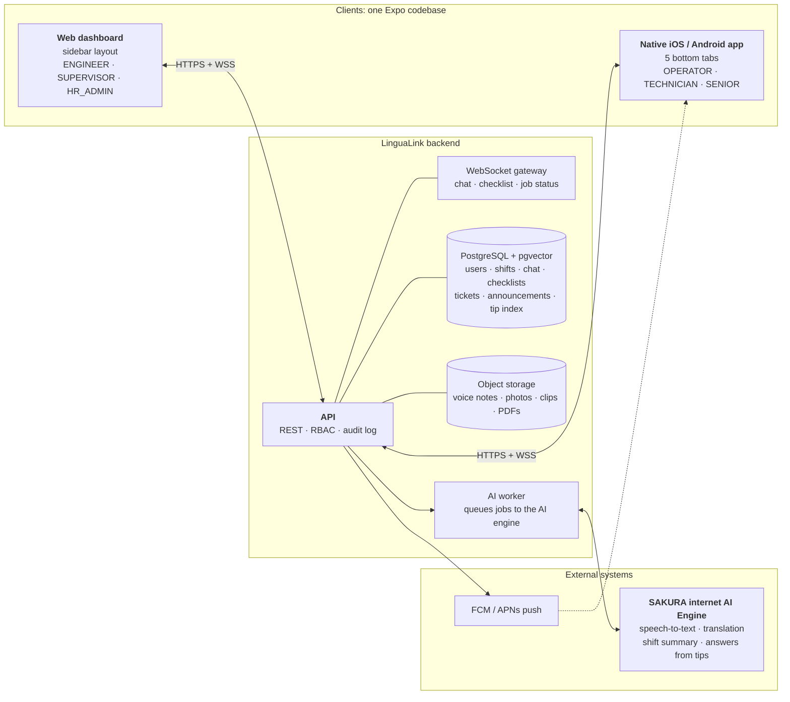
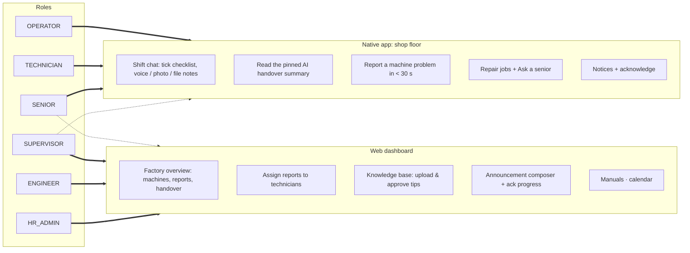
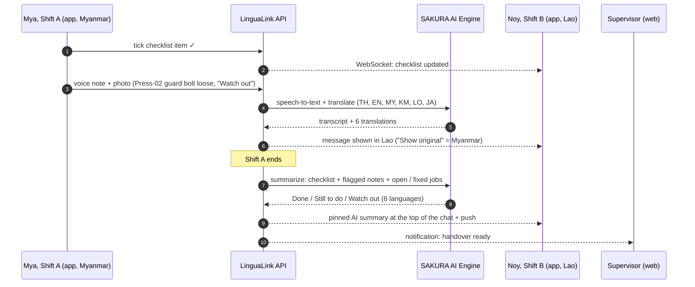
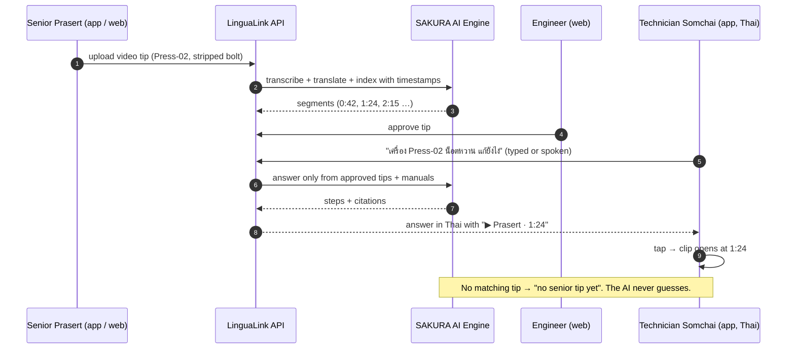
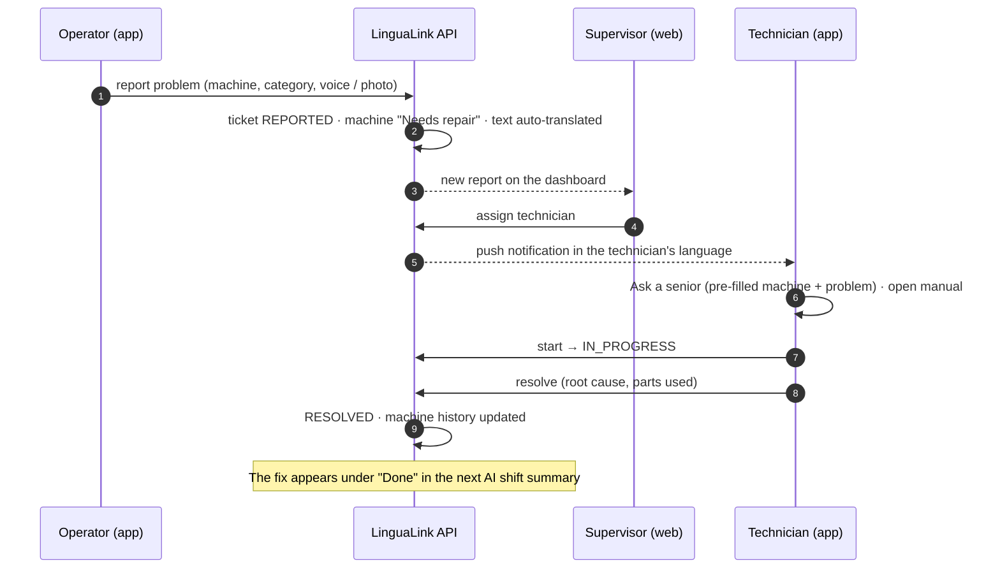
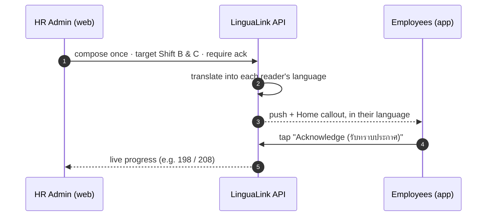

# LinguaLink: architecture and key user flows

Diagrams for LinguaLink, based on the PRD (`product_requirements_document_prd-2.md`, v2.0).
v2.0 **removed AI machine monitoring** (no telemetry, no AI risk warnings). The two core modules are **Smart Group Chat & AI Shift Handover** and **Senior Knowledge Base & AI Skill Transfer**.

## Stack decision

> **Note:** this replaces PRD §5.1 (React + Vite + Capacitor).

- **One Expo codebase** (Expo SDK 58, Expo Router, react-native-web) builds both clients.
- **Web comes first** for engineers, supervisors and HR, who work on big screens.
- **Mobile is a native iOS/Android app**, chosen for security: tokens in the device keychain (`expo-secure-store`), biometric login and no browser attack surface. It serves operators and technicians on the shop floor.
- Platform-specific UI uses Expo's file suffixes, for example `src/components/app-tabs.web.tsx` (web sidebar) and `src/components/app-tabs.tsx` (native tabs).
- **AI runs on SAKURA internet** (servers in Japan): speech-to-text, translation, shift summaries and knowledge-base answers.

---

## 1. System architecture

There is no connection to the machines themselves. Machine status is set by people (reports, repairs, PM).

---

## 2. Platform & role map

Thick arrow = main platform, dotted arrow = also uses it.

---

## 3. Key user flows

### 3.1 Shift chat → AI shift handover (FR-CH-01..04)

### 3.2 Ask a senior → answer with timestamp (FR-KB-01..04)

### 3.3 Manual breakdown report → resolved (FR-TK-01..03)

### 3.4 Targeted HR announcement → acknowledge (FR-HR-01..04, nice-to-have)

---

## 4. How the demo app maps to this

The demo (`npx expo start`) runs a small backend in its API routes (`src/app/api/*`). The web dashboard and the phone poll `/api/state` every 1.5 s.

- **Store** (`src/demo/server/store.ts`): the demo state. When `MONGODB_URI` is set, it is loaded from and saved to MongoDB on every request (`src/demo/server/db.ts`):
  - collection `state`: one document, with a version check so two servers or judges can't overwrite each other;
  - collection `messages`: the shift chat;
  - collection `usage`: the daily AI-call counter.

  Without `MONGODB_URI` it stays in memory.
- **AI** (`src/demo/server/ai.ts`, server only): Gemini API (`gemini-3.8-flash` by default, `GEMINI_MODEL` to change; JSON output) for:
  - translating free-typed chat into TH/EN/MY/KM/LO/JA and flagging *Watch out* messages;
  - writing the shift handover from the real checklist, chat and jobs;
  - answering *Ask a senior* questions (`/api/ask`) only from cited senior-tip moments. Cites that don't exist are dropped.
- **Fallback:** with no `GEMINI_API_KEY`, no internet or the daily cap reached, the scripted demo AI is used:
  - handover lists built from the checklist and chat;
  - a keyword matcher over `src/demo/mock/knowledge.ts`;
  - pre-written translations in `src/demo/mock/*` and `src/demo/i18n*.ts`.
- **Machine live** is a beta feature. It opens from the dashboard's *Machine live · Beta* button (`src/components/demo/machine-live.tsx`).

Setup: `docs/demo/AI-SETUP.md`.
